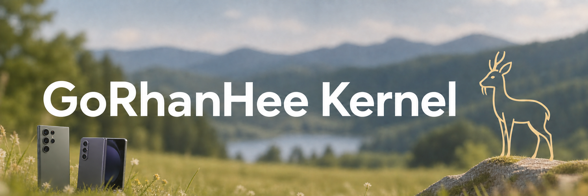

# GoRhanHee Kernel

  

## ⚠️ Disclaimer

- Designed for Samsung stock One UI firmware.
- One UI-based custom ROMs may be incompatible; UN1CA has been tested and confirmed working.
- AOSP builds are experimental and have not been boot-validated.

## 📱 Supported Devices

| Codename | Device | Status |
| --- | --- | --- |
| `dm1q` | Galaxy S23 | ✅ Supported |
| `dm2q` | Galaxy S23+ | ✅ Supported |
| `dm3q` | Galaxy S23 Ultra | ✅ Supported |
| `q5q` | Galaxy Z Fold5 | ✅ Supported |
| `b5q` | Galaxy Z Flip5 | ✅ Supported |

Korean and European variants use the same universal kernel. Device-specific
DTB/DTBO outputs remain separated so overlapping Qualcomm board IDs are never
combined into one ambiguous image.

## ✨ Features

- The `vanilla` build mode does not include KernelSU-Next or SUSFS.
- The `susfs` build mode adds KernelSU-Next and SUSFS 2.3.0 for Android 13 / Linux 5.15.
- Baseband Guard monitors unauthorized writes to protected partition devices.
- DroidSpaces support enables Linux containers through namespaces, IPC, netfilter, and matching DLKM modules.
- NTSync provides kernel synchronization primitives for Wine, Winlator, and GameHub.
- BBRv3 with TCP PLB is available for runtime network congestion control.
- FQ, FQ-CoDel, CAKE, PIE, NAT, IP sets, and IPv6 masquerading are enabled for network policy flexibility.
- Memory paths include optimized memset, memcpy, memcmp, page clearing, alignment, and cache-pressure tuning.
- Scheduler paths include CPU scan-order, cache-hot-buddy, and cpufreq minimum-frequency tuning.
- F2FS and ext4 include garbage-collection, congestion, fsync, and journal-commit tuning.
- Power management includes wakelock, alarmtimer, freeze-timeout, s2idle, and PCI PME wakeup tuning.
- Repetitive IRQ, healthd, logd, and dashd kernel messages are reduced.

## 📚 Credits

- [Android Common Kernel](https://android.googlesource.com/kernel/common/) — Android 13 / Linux 5.15 GKI base.
- [Qualcomm MSM Kernel](https://git.codelinaro.org/clo/la/kernel/msm-5.15) — SM8550 / Kalama platform source.
- [Samsung Open Source Release Center](https://opensource.samsung.com/) — Samsung device kernel source reference.
- [KernelSU-Next](https://github.com/KernelSU-Next/KernelSU-Next) — KernelSU-Next root integration.
- [SUSFS for KernelSU](https://gitlab.com/simonpunk/susfs4ksu/-/tree/gki-android13-5.15) — Android 13 / Linux 5.15 kernel integration reference.
- [KernelSU-Next SUSFS reference patch](https://github.com/xfwdrev/android_kernel_samsung_b4q/blob/sixteen/patches/0001-Enable-SuSFS-2.2.0-KSU-Next.patch) — KernelSU-Next-side SUSFS 2.2.0 integration reference.
- [AnyKernel3](https://github.com/osm0sis/AnyKernel3) — flashable kernel ZIP framework.
- [Baseband Guard](https://github.com/vc-teahouse/Baseband-guard) — Protected partition write monitoring.
- [DroidSpaces OSS](https://github.com/ravindu644/Droidspaces-OSS) — Linux container support reference.
- [Google BBR](https://github.com/google/bbr) — BBR congestion-control reference.
- [WildKernels](https://github.com/WildKernels) — Kernel optimization and feature patch reference.
